


**Software developer · Backend systems · Developer tools · Applied AI**

**[Email](mailto:arpit.kr.jaiswal@gmail.com)** &nbsp; / &nbsp; **[LinkedIn](https://www.linkedin.com/in/arpit-kumar-jaiswal-819478302)** &nbsp; / &nbsp; **[Repositories](https://github.com/arpitkjaiswal?tab=repositories)**

[Selected work](#01--selected-engineering-work) · [Engineering notes](./docs/engineering-notes.md) · [Architecture](#02--how-i-think-about-engineering) · [Technology](#03--technology-in-context) · [GitHub atlas](#04--building-in-public) · [Contact](#05--lets-talk)

I’m **Arpit Kumar Jaiswal**, a developer from **MIT Manipal** with a background in **Information Technology**. I work across **Python and TypeScript**, building applications that connect useful interfaces, explicit API contracts, and durable data workflows.

My work spans **repository analysis**, **explainable ranking**, and **policy-aware encrypted storage**. I care about making system behavior inspectable and connecting implementation choices to evidence.

**[Read the engineering walkthroughs](./docs/engineering-notes.md)** · **[Explore the repository network](#04--building-in-public)**

## 01 / Selected engineering work

Three implementations, each with a different engineering problem. Follow the source, design decisions, and recorded verification for a closer look.

<a href="https://github.com/arpitkjaiswal/NEXORA"></a>

### NEXORA — source analysis that leads somewhere useful

A repository analysis workspace that connects dependency maps, code findings, historical snapshots, and prioritized engineering reviews.

- **Built with:** React, TypeScript, Node.js, Vite, Docker, and Playwright.
- **Technical depth:** relative-import resolution, AST-based metrics, npm advisory checks, durable snapshots, and signed webhook ingestion with delivery deduplication.
- **Design choice:** a rules-based review path works without AI credentials; optional provider reviews have a documented metadata boundary.

[**Source**](https://github.com/arpitkjaiswal/NEXORA) · [**Engineering walkthrough**](./docs/engineering-notes.md#nexora--turn-source-analysis-into-something-a-developer-can-use) · [Build & verification](https://github.com/arpitkjaiswal/NEXORA#validation)

 

<a href="https://github.com/arpitkjaiswal/Candidate-Ranking-System"></a>

### TalentOS — evidence behind the ranking

A candidate intelligence workspace that turns resumes and role requirements into explainable scores, excerpts, skill gaps, and reviewable workflow state.

- **Built with:** React, TypeScript, FastAPI, scikit-learn, SQLAlchemy, Alembic, and PostgreSQL/SQLite.
- **Technical depth:** bounded extraction subprocesses, independent resume/JD scoring, transactional batch uploads, optimistic versions, and stale-write protection.
- **Design choice:** an explicit lexical/skill model keeps results inspectable. The private Resume Lab processes a resume without persisting its profile.

[**Source**](https://github.com/arpitkjaiswal/Candidate-Ranking-System) · [**Engineering walkthrough**](./docs/engineering-notes.md#talentos--make-a-ranking-explainable-and-reviewable) · [Architecture](https://github.com/arpitkjaiswal/Candidate-Ranking-System/blob/HEAD/docs/ARCHITECTURE.md) · [Recorded verification](https://github.com/arpitkjaiswal/Candidate-Ranking-System/blob/HEAD/docs/VALIDATION.md)

<b>Product preview — recruiter workspace with synthetic demonstration data</b>

 

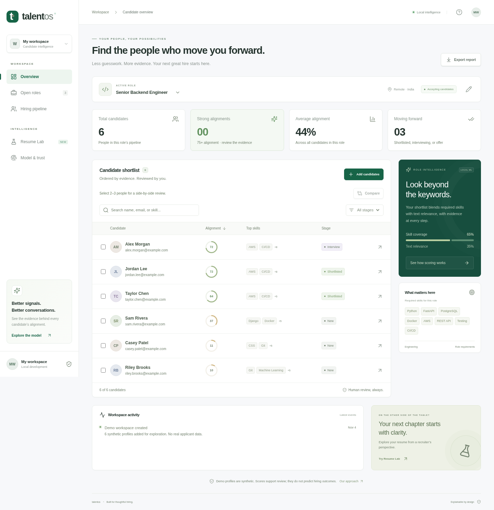

Original screenshot from the [project documentation](https://github.com/arpitkjaiswal/Candidate-Ranking-System/blob/b3b70df9248662c7c166f1c36c49a75c78eae4c2/docs/overview.png). Example candidates and scores describe the demonstration workspace.

 

<a href="https://github.com/arpitkjaiswal/AegisVault"></a>

### AegisVault — explicit policy, encryption, and audit semantics

An encryption research prototype that connects policy-gated document operations, tenant-scoped exact search, and authenticated audit chains.

- **Built with:** Python, FastAPI, cryptography, SQLAlchemy, PostgreSQL, pytest, and Hypothesis.
- **Technical depth:** manifest-bound interpretation, authenticated encryption, transactional record/term updates, optimistic revisions, and serialized audit-head updates.
- **Design choice:** plaintext release depends on the read-audit transaction committing. Search leakage and key-custody responsibilities are part of the documented boundary.

**Scope:** research prototype; not independently security-audited.

[**Source**](https://github.com/arpitkjaiswal/AegisVault) · [**Engineering walkthrough**](./docs/engineering-notes.md#aegisvault--make-the-data-boundary-explicit) · [Security boundaries](https://github.com/arpitkjaiswal/AegisVault/blob/HEAD/docs/security.md) · [Recorded verification](https://github.com/arpitkjaiswal/AegisVault/blob/HEAD/docs/status.md)

<b>More work: voice interfaces, computer vision, document search, and developer tools</b>

 

| Project | What to explore | Stack |
| :--- | :--- | :--- |
| [**LEXA**](https://github.com/arpitkjaiswal/LEXA) | macOS-first AI desktop companion with voice recognition and allowlisted local skills | Python · Whisper · PySide6 |
| [**LeafScan**](https://github.com/arpitkjaiswal/CNN) | Leaf-photo classification, account flows, and private scan history | React · Express · MongoDB · PyTorch |
| [**DevOS**](https://github.com/arpitkjaiswal/DevOS-AI-Software-Engineering-Agent) | Read-only repository investigations with durable run state and human review | FastAPI · SQLite · MCP |
| [**DocumentAnalyser**](https://github.com/arpitkjaiswal/DocumentAnalyser) | PDF/DOCX extraction, document retrieval, and optional provider-backed answers | FastAPI · scikit-learn · SQLite |
| [**URLShortener**](https://github.com/arpitkjaiswal/URLShortener) | Link management, aliases, expiry, QR downloads, and private analytics | FastAPI · SQLAlchemy · PostgreSQL |
| [**veildb**](https://github.com/arpitkjaiswal/veildb) | Searchable-encryption research for PostgreSQL applications | Python · cryptography · SQLAlchemy |
| [**Concord**](https://github.com/arpitkjaiswal/Concord) | A workspace for organizing ideas and getting work done | React · TypeScript · Vite |
| [**CommitSync**](https://github.com/arpitkjaiswal/CommitSync) | Chrome extension for syncing accepted LeetCode solutions to GitHub | JavaScript · Browser APIs |

## 02 / How I think about engineering

I like working through the whole path from an interface to the system behavior behind it: the contract, the state transition, the failure mode, and the evidence that a change works.

| Principle | Concrete example |
| :--- | :--- |
| **Make outputs inspectable.** | Navigate a source finding in NEXORA; inspect terms, excerpts, and score components in TalentOS. |
| **Make state changes explicit.** | Transactional uploads and stale-write protection in TalentOS; record, search-term, and audit updates in AegisVault. |
| **Treat boundaries as design decisions.** | Bounded extraction workers, provider data boundaries, tenant/purpose policy, and documented deployment scope. |
| **Connect implementation to verification.** | API tests, browser flows, database checks, and reproducible commands in the project documentation. |


[**Read the design decisions and tradeoffs**](./docs/engineering-notes.md)

## 03 / Technology in context

My main tools are **Python and TypeScript**. I use the surrounding stack where it fits the problem, and keep the implementation scope visible in each repository.


<b>Stack details and where each tool appears</b>

 

| Area | Tools | Example repositories |
| :--- | :--- | :--- |
| Frontend | React · TypeScript · Vite · HTML · CSS | NEXORA, TalentOS, Concord |
| APIs & validation | FastAPI · Pydantic · Node.js · Express · HTTPX · MCP | DevOS, NEXORA, LeafScan |
| Persistence | PostgreSQL · SQLAlchemy · Alembic · SQLite · MongoDB · optional Redis | AegisVault, TalentOS, LeafScan, URLShortener |
| ML & data | PyTorch · scikit-learn · NumPy · Pandas · SciPy · Matplotlib · Seaborn | LeafScan, candidate ranking, data-analysis projects |
| Voice & providers | Whisper · PySide6 · OpenAI · Anthropic · optional Ollama | LEXA |
| Delivery & verification | Docker · GitHub Actions · pytest · Playwright · Hypothesis · Ruff · uv | NEXORA, AegisVault, TalentOS |
| Programming foundations | Java · C · C++ · JavaScript · SQL · Verilog | Coursework, algorithms, and programming foundations |

These tools reflect project manifests, documentation, and my stated foundations. Some integrations are optional; each repository describes its implementation scope. Forks are excluded from the language graph below.

## 04 / Building in public

### The GitHub Work Atlas

A connected map of my public non-fork repositories: project areas on the outside, documented tools in the middle, and primary languages at the core.

<a href="https://raw.githubusercontent.com/arpitkjaiswal/arpitkjaiswal/main/assets/work-atlas.svg"></a>

[**Open the full-size graph**](https://raw.githubusercontent.com/arpitkjaiswal/arpitkjaiswal/main/assets/work-atlas.svg) · [Download the interactive explorer](https://raw.githubusercontent.com/arpitkjaiswal/arpitkjaiswal/main/assets/work-atlas.html) · [Graph data](./assets/work-atlas-data.json)

Save the explorer HTML file and open it in a browser to **search, filter, pan, zoom, and inspect each connection**. It works offline; GitHub displays the animated image here.


  
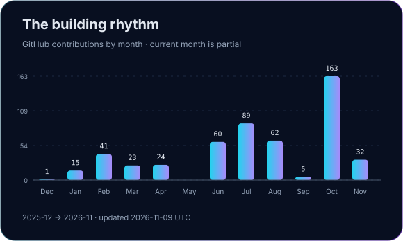

<b>Data sources and graph methodology</b>

 

- **Calendar:** contributions displayed on my public GitHub calendar. The moving light is decorative.
- **Monthly chart:** contributions grouped into the latest 12 calendar months; the current month is partial.
- **Languages:** one GitHub-detected primary language per public non-fork repository. This profile and repositories without a detected language are excluded. Counts describe repositories, not lines of code or proficiency.
- **Work atlas:** includes every public non-fork project repository, including those without a detected language. Project areas are curated; tool links come from reviewed manifests and READMEs. Links describe primary languages or documented tool use, not dependencies between repositories. Motion is decorative.
- **Updates:** the daily workflow refreshes the checked-in graphics. During GitHub HTTP outages, it warns and preserves the dated snapshot. Snapshot dates remain unchanged until fresh data is fetched successfully.

[Data snapshot](./assets/profile-data.json) · [Refresh script](./scripts/update_profile.py) · [Workflow runs](https://github.com/arpitkjaiswal/arpitkjaiswal/actions/workflows/profile-visuals.yml)

## 05 / Let’s talk


**Open to software engineering opportunities, internships, and collaborations.** I’m interested in teams building developer tools, backend systems, and useful AI applications. I’d be glad to walk through the code, explain a design decision, or discuss a problem your team is working on.

**[Email me](mailto:arpit.kr.jaiswal@gmail.com)** · **[Connect on LinkedIn](https://www.linkedin.com/in/arpit-kumar-jaiswal-819478302)** · **[Browse the code](https://github.com/arpitkjaiswal?tab=repositories)**
