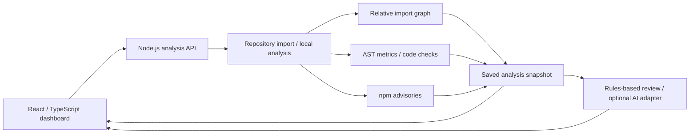
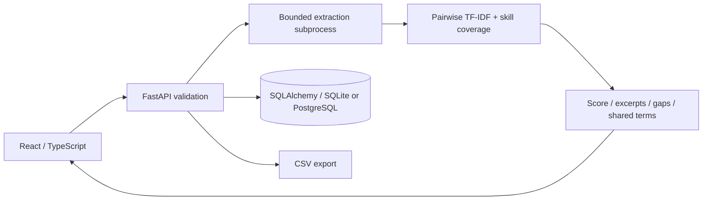
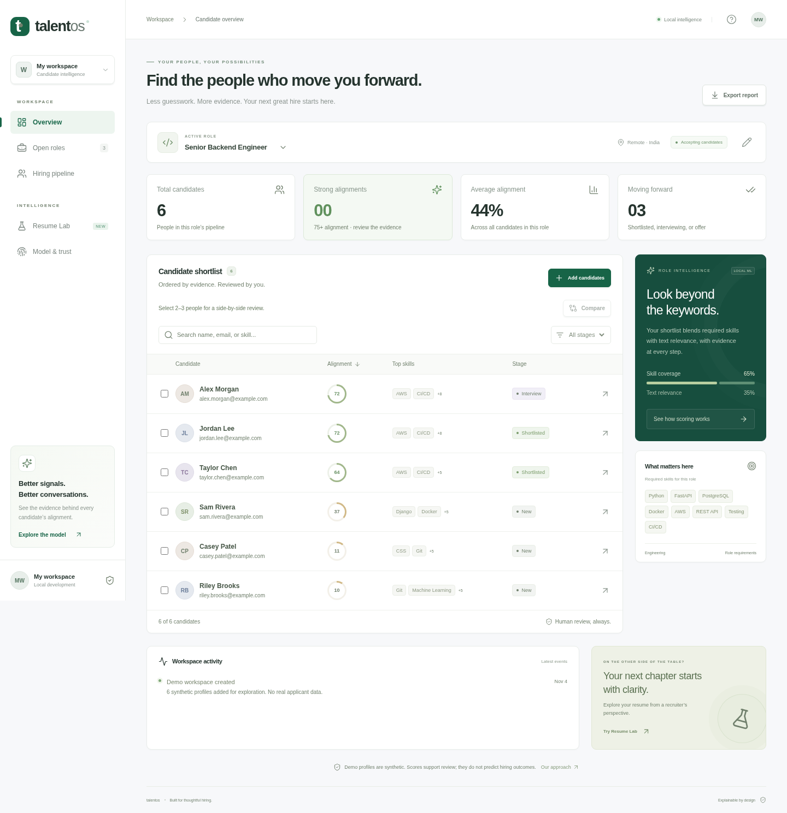
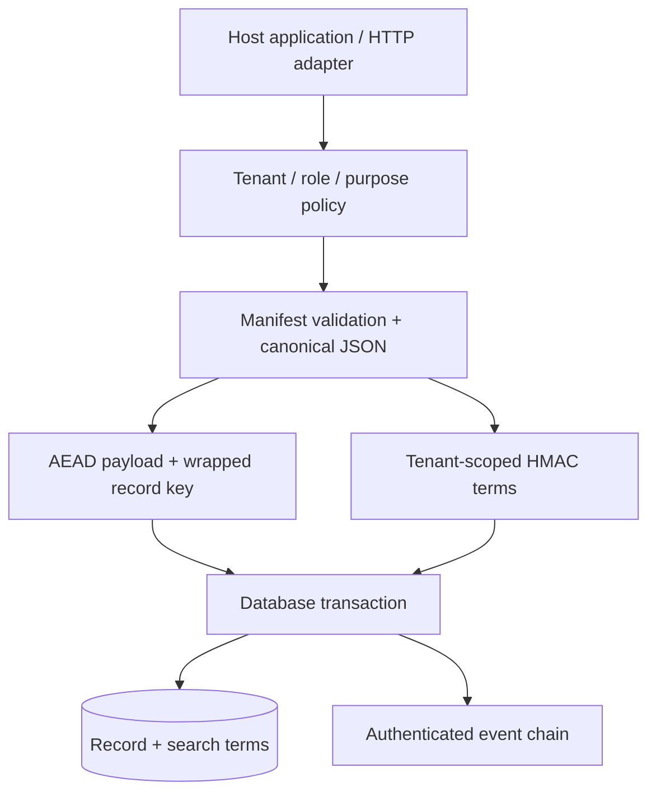

# Engineering notes

Three project walkthroughs: the problem, the implementation, the tradeoff, and the evidence a reviewer can inspect.

These notes summarize the source revisions linked below. Validation links point to each project's recorded results; the profile's own checks cover its artwork, graph data, and refresh behavior.

## NEXORA — turn source analysis into something a developer can use

**Problem.** Repository findings become more useful when a developer can navigate the code relationships, inspect the evidence, and compare results over time.

**Implementation.** A React/TypeScript dashboard calls a Node.js analysis API. The analyzer discovers source files, resolves relative JavaScript/TypeScript imports, computes AST-based complexity signals, checks code patterns and npm advisories, and stores snapshots. The interface connects findings, graph navigation, reviews, and JSON exports.

**Decisions worth inspecting.**

- A rules-based review path works without an AI credential. Provider-backed reviews are an explicit option with a documented data boundary: findings and graph metadata are sent, rather than source text.
- Saved snapshots make analysis inspectable over time. Graph nodes describe resolved imports; they are not a deployment topology.
- Signed GitHub webhook events use delivery IDs to avoid duplicate jobs. Results stay in the workspace; automatic PR-comment publication is outside this implementation.

**Tradeoff.** Static signals are prompts for investigation. Complexity estimates are not runtime benchmarks, and pattern findings need context. The graph resolves relative JS/TS imports rather than every language or package-resolution mode.

**Review route.** Read the analyzer/API tests and the browser flows alongside the implementation. The project documents build, lint, backend, browser, and container checks.

[Source revision `fb6dc88`](https://github.com/arpitkjaiswal/NEXORA/tree/fb6dc88716f0827f06077d8ac8b7e165c5eac0ea) · [Architecture, configuration, and verification](https://github.com/arpitkjaiswal/NEXORA/blob/fb6dc88716f0827f06077d8ac8b7e165c5eac0ea/README.md) · [Build and test commands](https://github.com/arpitkjaiswal/NEXORA/blob/fb6dc88716f0827f06077d8ac8b7e165c5eac0ea/package.json)

## TalentOS — make a ranking explainable and reviewable

**Problem.** A score alone gives a reviewer little to inspect. A useful candidate workspace needs evidence, clear scoring rules, durable workflow state, and explicit limits on what the model means.

**Implementation.** A React/TypeScript client shares a FastAPI parsing and ranking boundary between recruiter workflows and Resume Lab. Document extraction runs in disposable, bounded subprocesses. scikit-learn computes lexical relevance and skill coverage; SQLAlchemy persists recruiter records, with Alembic migrations and SQLite/PostgreSQL support.

**Decisions worth inspecting.**

- The scoring contract is explicit: `0.65 × skill coverage + 0.35 × lexical relevance`. Word/bigram and character n-gram signals contribute to lexical relevance.
- Each resume/job-description pair is fitted independently. Adding a different candidate does not change an existing candidate's score.
- Recruiter uploads use transactional persistence and duplicate detection. Batch savepoints let valid records survive a different file's failure.
- Optimistic versions and role-level compare-and-swap protect edits and recalculation from stale writes.
- Resume Lab processes a resume in memory without writing its profile to the application database. The production workspace and the private analysis path have distinct retention behavior.

**Tradeoff.** Lexical scoring is local and inspectable, but has weaknesses around synonyms, keyword stuffing, and proxy signals. It organizes evidence for human review; it is not a probability of employment or a predictor of job performance. The application is a single-workspace portfolio product.

**Review route.** Inspect the model contract, bounded extraction, stale-write tests, and database operations. The project's validation record covers backend tests, browser flows, production builds, and PostgreSQL/container checks, with the observed environment and date stated there.

[Source revision `b3b70df`](https://github.com/arpitkjaiswal/Candidate-Ranking-System/tree/b3b70df9248662c7c166f1c36c49a75c78eae4c2) · [Architecture and scoring contract](https://github.com/arpitkjaiswal/Candidate-Ranking-System/blob/b3b70df9248662c7c166f1c36c49a75c78eae4c2/docs/ARCHITECTURE.md) · [Recorded validation](https://github.com/arpitkjaiswal/Candidate-Ranking-System/blob/b3b70df9248662c7c166f1c36c49a75c78eae4c2/docs/VALIDATION.md)

<strong>Product screenshot — synthetic demonstration data</strong>

 

This image is copied unchanged from the project's `docs/overview.png` at the source revision above. Its example candidates and scores describe the demonstration workspace.

## AegisVault — make the data boundary explicit

**Problem.** Encrypted storage still needs an application contract: who may read a record, how search is scoped, how concurrent changes behave, and what the audit trail can establish.

**Implementation.** The Python SDK and HTTP adapter expose explicit document operations. Policy checks precede manifest validation and canonical encoding. Payloads use authenticated encryption; tenant-scoped HMAC terms support exact search. SQLAlchemy coordinates record, term, and audit updates with PostgreSQL as the intended database and SQLite as a development dialect.

**Decisions worth inspecting.**

- Manifest fingerprints bind stored data to a declared interpretation. The system refuses an unapproved contract change rather than silently evolving that interpretation.
- Replacing a document replaces its search terms in the same transaction. Search authenticates candidates and checks their semantics before returning results.
- PostgreSQL audit-head locking, compare-and-swap, and sequence uniqueness reject stale writers. Concurrent first-use initialization can return a retryable conflict.
- Plaintext is released only after the corresponding read-audit transaction commits. A failed transaction therefore affects the operation's externally visible result.
- Key custody remains a host responsibility. Search leakage and security boundaries are documented parts of the design.

**Tradeoff.** Exact-search terms intentionally reveal some structure. SQLite has more restrictive write concurrency than PostgreSQL. This is an encryption research prototype, not an independently audited security product.

**Review route.** Read the threat boundaries before the API surface. Then inspect transaction behavior, revision conflicts, database tests, and the dated verification record.

[Source revision `6c1b7f9`](https://github.com/arpitkjaiswal/AegisVault/tree/6c1b7f93b094b9e89acdcf0df932c72ad2e73287) · [Architecture](https://github.com/arpitkjaiswal/AegisVault/blob/6c1b7f93b094b9e89acdcf0df932c72ad2e73287/docs/architecture.md) · [Security boundaries](https://github.com/arpitkjaiswal/AegisVault/blob/6c1b7f93b094b9e89acdcf0df932c72ad2e73287/docs/security.md) · [Recorded status](https://github.com/arpitkjaiswal/AegisVault/blob/6c1b7f93b094b9e89acdcf0df932c72ad2e73287/docs/status.md)

---

[Back to the profile](../README.md) · [Explore the work atlas](../assets/work-atlas.svg) · [Contact Arpit](mailto:arpit.kr.jaiswal@gmail.com)
